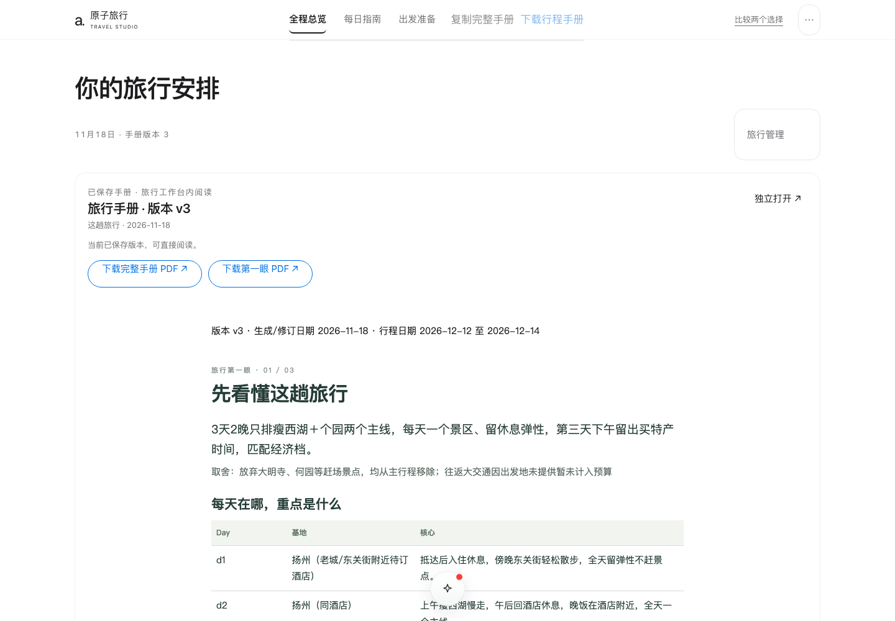
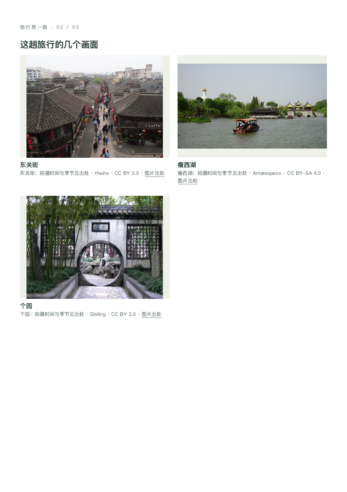
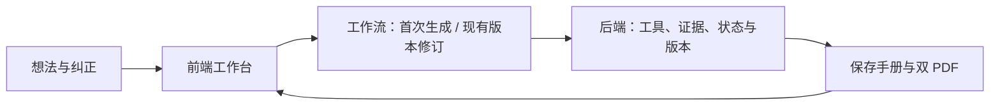

# Trip Autopilot

**从一句旅行想法，到一份有依据、可修改、可带走的旅行手册。**

Trip Autopilot 是一个旅行规划 Agent 原型。它围绕你的日期、同行人、预算、节奏和已订安排组织旅行资料，生成可继续修改的手册，并提供完整版与「第一眼」速览 PDF。

[看 90 秒真实演示](docs/DEMO.md) · [读完整手册](docs/examples/yangzhou-v3-full.pdf) · [读第一眼速览](docs/examples/yangzhou-v3-first-eye.pdf) · [授权运行](docs/RUNNING.md) · [技术架构](docs/ARCHITECTURE.md)

*扬州案例真实操作后的 v3 工作台。点击图片查看演示与交付说明。*

## 先看一次真实修改

2026-11-18，我们从已有扬州行程的缓存 v2 出发，在真实前端提交一次纠正，得到保存后的 v3、修改回执和两份对应版本的 PDF。

> 第二天不去大明寺，瘦西湖后回酒店休息，晚饭在酒店附近；其他两天及日期、人数、预算上限保持。

| 修改前 | 用户提出的变化 | 保存后的 v3 |
| --- | --- | --- |
| 第二天包含大明寺 | 取消这一站，留出酒店休息与附近晚餐 | 第二天日程与第一眼路线同步调整 |
| 第一、三天已有安排 | 其他两天保持 | 两天的完整结构保持不变 |
| 当前手册为 v2 | 修改后继续阅读、带走 | v3 刷新恢复；HTML 与双 PDF 绑定同一版本 |

**实际等待 8 分 15 秒，视频压缩为 90 秒。** 一次用户提交经历了内部旧值匹配重试，共新增 4 次产品调用；费用保守估算约 ¥1.65，服务商实际账单未知。

这次演示验证了缓存续改的限定链路。它没有验证从零首册一次成功，也没有重新核验全册旅行事实；购物活动仍缺图，照片覆盖为 3/4，展示为 `degraded`，与 API 的 `ready` 存在状态差异。

[查看视频、PDF 与完整演示口径 →](docs/DEMO.md)

## 希望替你省下的三件事

### 1. 少做资料拼接

从一句想法开始，不要求先上传攻略。把景点、交通、住宿、餐饮与休息放到同一份安排里，让日期、人数、预算口径和待确认项靠近相关内容。

### 2. 少做改动后的返工

用自然语言说明哪里要改、哪里保持。Agent 在当前手册上调整受影响内容，同步日程与速览，留下实际差异和修改回执；版本保护阻止旧内容覆盖新结果。

### 3. 带走能继续使用的结果

工作台阅读保存后的手册；完整 PDF 用于详细准备，第一眼 PDF 用于快速查看路线与重点。页面、修订与导出围绕同一份正式版本。

*本次成品：18 页完整手册、3 页第一眼速览。已知缺口随演示说明保留。*

## 它怎样理解并安排一次旅行

**从意图开始。** 日期、人数、已订事项是明确条件；喜欢什么、愿意舍弃什么影响取舍。只追问会改变方案的问题，暂定假设保持可撤回，不把年龄或同行关系直接当作偏好。

**把供给拆成可组合的单元。** 一个景点、一段交通、一家住宿或一种体验，都带上来源、核验时间、适用条件与未知项。这些「供给原子」可以被研究、比较和重新组合，但候选信息不等于实时库存。

**读资料，再形成中文手册。** 研究规格要求按问题使用中文、英文与目的地当地语言资料。搜索发现线索，读取原文才进入证据判断；同一篇资料的翻译或转载不算独立来源，单源保留「未交叉确认」。多语言覆盖与核验质量仍需逐次观察。

**把能力放在需要它的位置。** 比较帮助做选择，意图追问澄清条件，供给研究补充依据，局部修订处理变化，手册组装形成交付。仓库保留这些模块和实验路径；模块存在不代表所有入口都已联通，选择比较结果也不会自动改写手册。

更多产品判断与验收方法见 [产品逻辑](docs/PRODUCT-LOGIC.md)。

## 一个行程，三个顺序协作的角色

首次生成按研究、裁决、成文依次推进，各自有独立会话和预算，共享持久化资料。

| 角色 | 做什么 | 交给下一步什么 |
| --- | --- | --- |
| Research · 研究 | 搜索、读原文、整理候选与缺口 | 来源、原文片段与待核事项 |
| Adjudicator · 裁决 | 核对实体、日期、条件与引用 | 绑定来源的证据与未决项 |
| Writer · 成文 | 按需求组织日程，保存草稿、检查并补改 | 正式手册与保存回执 |

三个角色按顺序交接。后续纠正直接编辑当前正式版本；本次演示展示的是这一修订路径。角色分工与检查能约束执行，不能独自证明内容正确。

模型负责理解、研究、选择和调整；运行环境负责保存真实工具结果，维护预算、版本、失败与恢复状态。前端展示服务端保存的同一手册。

[查看角色交接、数据归属和代码索引 →](docs/ARCHITECTURE.md)

## 当前状态

| 已有证据 | 尚未解决或验证 |
| --- | --- |
| 扬州缓存 v2 → v3 的修改、保持、刷新和双 PDF 导出 | 从零新行程的首次自主完整交付 |
| 修改回执、版本绑定与已有结果恢复 | 小修订仍耗时，本次约 8 分 15 秒 |
| 本次 3 个核心景点照片与每日地图在位 | 购物活动缺图；API 与展示状态口径不一致 |
| 发布包回归与隔离空目录启动检查 | 这些检查不代表真实模型、公网服务或全部事实验收 |

自动长期记忆、后台持续跟进、预订付款、跨浏览器凭据恢复，以及当前单会话的附件理解与完整撤销，未计为已交付能力。

本次源码与文档发布基于 2026-11-18 冻结构建 `a5adb2979c816bfd`，保留两处既有渲染目录适配；**没有重新部署现有服务，也没有因发布新增模型调用。**

复验结果、例外与后续事项见 [发布说明](docs/RELEASE-2026-11-18.md)。

## 体验与阅读入口

| 想做什么 | 从这里开始 |
| --- | --- |
| 先看产品实际怎样修改行程 | [90 秒演示与说明](docs/DEMO.md) |
| 直接检查成品 | [完整 PDF](docs/examples/yangzhou-v3-full.pdf) · [第一眼 PDF](docs/examples/yangzhou-v3-first-eye.pdf) |
| 理解产品判断与能力边界 | [产品逻辑](docs/PRODUCT-LOGIC.md) |
| 理解实现与状态归属 | [技术架构](docs/ARCHITECTURE.md) |
| 在获得授权后本地运行 | [运行说明](docs/RUNNING.md) |
| 检查本版实际验证了什么 | [2026-11-18 发布说明](docs/RELEASE-2026-11-18.md) |

本地运行需要授权解密后端、安装依赖、配置有效的模型凭据与独立数据目录，再从 `/studio.html` 进入。研究与媒体能力还依赖网络、来源可达性及相应服务配置。

## 仓库与授权

| 路径 | 内容 |
| --- | --- |
| `apps/v1/` | Studio 前端、保存手册、修订反馈与下载入口 |
| `tools/` | 服务入口、预览、渲染与辅助工具 |
| `core/runtime-reliability-20261118.tar.gz.enc` | 本版加密后端源码与回归测试；解密后得到 `packages/`、`tests/` |
| `docs/` | 产品、架构、运行、发布说明与演示成品 |

后端源码为作者保留的 IP，以 AES-256-CBC、PBKDF2 加密交付，口令单独提供给授权使用者。**公开仓库不代表后端获得开源授权。** 密钥、私有会话与原始付费回包不随仓库分发；`core/` 旧包仅供历史追溯。
