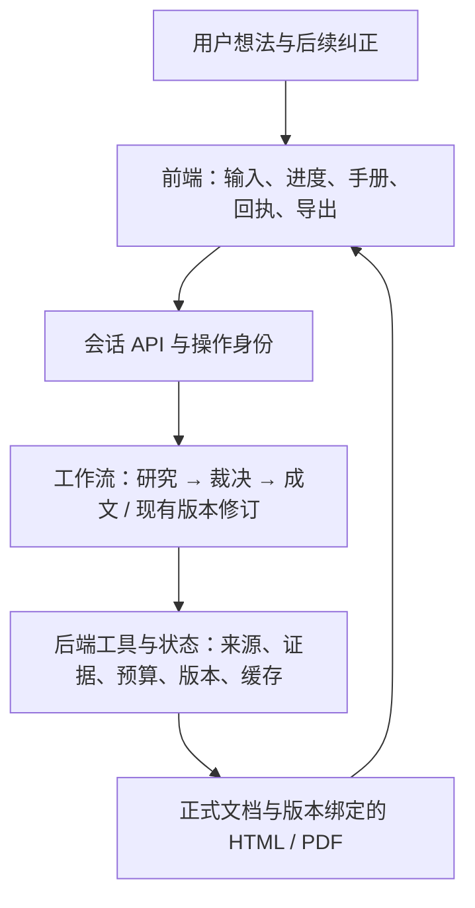

# Trip Autopilot

**把分散的旅行信息、个人需求与可追溯证据，组织成一份能继续修改的旅行手册。**

Trip Autopilot 是一个旅行规划 Agent 原型。用户从一句旅行想法开始，系统围绕日期、同行人、预算、节奏和已订安排做研究与取舍，在同一行程会话里生成、修订和保存手册，并提供 HTML、完整版 PDF 与「第一眼」速览 PDF。

项目关注的结果是：用户少做多少研究、核对、协调和返工。功能数量、搜索次数和生成字数只是过程指标。

[产品思路](docs/PRODUCT-LOGIC.md) · [技术架构](docs/ARCHITECTURE.md) · [运行说明](docs/RUNNING.md) · [本次发布与验证边界](docs/RELEASE-2026-11-18.md)

## 当前版本

本次发布以 2026-11-18 冻结构建 `a5adb2979c816bfd` 为基础，同步源码与回归材料，并保留两处既有的可移植渲染目录适配，**不代表线上服务已重新部署**，也没有因发布新增模型调用。

当前有真实证据支持的演示是：从缓存行程出发，一次用户纠正产生新版本，刷新后恢复同一版本，并下载对应的 HTML 和两份 PDF。

从零新建行程的一次自主交付、持续低延迟修订、完整图片覆盖，仍是需要进一步验证的目标。离线测试通过和已有缓存演示都不能替代这些验收。

## 要解决的旅行问题

一份旅行攻略往往把困难留给了读者：信息是否仍有效、不同地点能否衔接、预算对应几个人、老人孩子能否承受、临时改一天会影响什么。

Trip Autopilot 尝试接手这些工作：

- 理解用户真正要保留的体验、明确条件和可以调整的偏好。
- 将景点、交通、住宿、餐饮与必要服务组合成适合这一次出行的安排。
- 围绕关键决定读原始资料，保留出处、适用条件和未知项。
- 让休息、换乘、天气替代、行前待办进入实际日程。
- 接受自然语言纠正，修改受影响部分并保留其他有效安排。

这是一套持续准备和调整旅行的产品探索。预订、付款、取消和供应商联系没有被包装成已经完成的能力。

## 用户如何使用

### 1. 从想法开始

提供目的地或方向、日期、同行人和你在意的事情，不要求先上传完整资料。

例如：「三天慢慢玩，下午要能休息，已订的酒店不动。」这是需求示例，不是对某个目的地的事实承诺。

### 2. 用少量交互澄清取舍

系统的设计原则是只问答案会改变方案的问题。可以暂定的事项，用明确、可撤回的假设推进；假设不会自动变成用户确认。

独立的意图追问模块支持零到三个问题及其方案影响。当前单会话主路径也通过模型指令采用这一原则；两者的集成和验收范围分别记录。

### 3. 阅读保存后的手册

旅行工作台展示同一份服务端保存的 HTML，包括总览、逐日安排、交通与休息、预算口径、图片、路线及必要复核项。

内部来源台账和调用日志服务于追溯，不直接替代读者需要的旅行内容。

### 4. 继续提出纠正

例如：「第二天下午取消一个景点，回酒店休息，其他两天保持。」

Agent 在当前版本上编辑，同步受影响的日程、摘要和速览，并留下修改回执与实际 diff。版本冲突会拒绝写入，避免用旧内容覆盖新结果。

### 5. 带走同一版本

HTML、完整手册 PDF 与第一眼 PDF 绑定保存版本。导出读取已有产物；页面能展示下载按钮，还需要满足相应产物状态。

第一眼 PDF 只有达到 `ready` 才作为普通下载展示。产物存在、可以下载和内容质量达标是不同状态。

## 我们对 Trip Copilot 的思考

Trip Copilot 应围绕三件事建立价值：理解用户真正想完成的旅行，组织分散且条件各异的供给，在需求变化时重新编排并保留有效安排。用户面对的是选择和结果；模型负责判断，能力组件负责执行，证据决定哪些内容可以明确承诺。

更强模型可以改善判断，但不会自动解决供给可用性、信息同步、行程衔接和版本一致性。我们希望把这些能力做成可迁移的产品基础，让换目的地主要换输入和资料，而不重写城市规则。这个方向仍需要用跨目的地的真实结果持续检验。

## 产品逻辑：从供给到个人行程

### 供给原子

旅行供给可以拆成可组合的单元：一个景点、一段交通、一家住宿、一种体验，以及它们的价格、开放、适用条件和来源。

系统保留供给研究、来源适配、结构化候选、证据缓存和生命周期模块。它们让信息具有来源、时间和适用范围，而不是成为无法追溯的一段文字。

「供给」也包括未确认的线索。一个网页候选不会因为进入库中就自动变成可订库存或已核事实。

### 个性化编排

同一组供给可以服务不同的人。模型结合用户意图做体验选择、节奏安排、优先级判断和局部调整，程序维护已确认条件、数据版本和执行边界。

个性化不应依赖刻板印象。年龄、同行关系和用户没有否认的默认值，不能自动升级为偏好。

### 可复用能力

比较、意图追问、局部修订、供给研究与手册组装被拆为有明确输入输出的能力。它们可以独立演进，并由产品工作流在合适的时点调用。

当前发布同时保留主链路与能力实验代码。模块存在、接入当前入口和真实用户路径通过，是三个不同的判断。

## 模型与 Harness 的分工

这里的 Harness 指包围模型的运行环境：工具、状态、预算、版本、校验、持久化与恢复机制。

| 工作 | 模型负责 | 程序负责 |
| --- | --- | --- |
| 理解需求 | 判断哪些条件影响方案，提出有价值的问题 | 保留用户原话、明确确认与暂定假设 |
| 研究事实 | 选择来源，判断实体、日期和适用条件 | 保存实际读到的原文、出处和内容 hash |
| 形成方案 | 选择体验，组织日程，处理条件分支 | 提供结构、时间余量计算和预算乘式 |
| 修改行程 | 判断直接影响，同步关联内容 | 校验版本与旧值，保存 diff 和回执 |
| 交付与恢复 | 对剩余不确定性给出可用表达 | 保存正式版本、绑定产物、记录失败和调用账 |

字符串匹配可以证明引文来自某段原文，不能证明它适用于这位用户。时间算式可以发现已知字段的重叠，不能证明未知交通可行。两类判断需要协作。

## 当前主路径：一个行程，三个角色

首次生成使用研究、裁决、成文三个有边界的角色会话，按顺序推进：

| 角色 | 主要任务 | 关键边界 |
| --- | --- | --- |
| Research | 检索线索、读取原文、整理候选与缺口 | 搜索摘要不直接成为已核证据 |
| Adjudicator | 核对原文、实体、日期、条件并登记证据 | 未绑定来源的候选保持未知 |
| Writer | 根据用户需求和证据组织、补齐并发布手册 | 不能新造证据编号或用未绑定金额冒充核价 |

角色共享持久化的来源、证据和文档，通过索引、逐字片段、明确缺口与定向读取交接。每个角色有独立对话和预算记录，当前实现不宣称三个角色同时并行规划。

成文先保存可编辑草稿，再检查具体缺项、局部补改，最后发布正式文档。后续用户纠正直接编辑当前正式版本。

这种分工增加了交接成本，也暴露了上下文膨胀、重复阅读和小改动变慢的问题。项目通过受限工具、定向读取、版本化产物和可复核调用账处理这些问题；实际延迟仍需单独验证。

## 前端、工作流、后端三部分

- **前端**把已有结果持续展示给用户，明确当前版本、新一轮状态和可执行操作。
- **工作流**决定当前要完成什么，以及角色如何共享资料、发现缺口和继续修订。
- **后端**提供可调用能力、持久化和约束，防止过期写入、错误金额绑定与无界重复调用。

更完整的入口、数据归属和代码索引见 [技术架构](docs/ARCHITECTURE.md)。

## 研究与事实校准

研究规格要求围绕具体旅行问题使用中文、英文与目的地当地语言资料，在适用且可得时互相补充，再形成中文读者内容。

这是一项研究策略与生成要求。当前没有证明所有目的地、所有能力都已实现稳定的多语言检索和独立交叉核验。

系统采用以下事实纪律：

1. `search` 发现线索，`read_page` 读取原文，证据登记绑定实际引文。
2. 价格、营业与政策根据声明类型选择主要依据，核对同一实体、日期与条件。
3. 单源保留「未交叉确认」；转载、翻译和同一上游内容不能当作独立来源。
4. 未来拥挤、座位、库存等无法保证的事项保留条件，不把建议写成确认。
5. 已核价格使用证据标记与人数乘式；估算独立列假设，未知不当作零。

局部缺证应影响相关承诺和表达。程序保留缺口，模型需要给出条件方案，避免为了一个查不到的细节无限研究。

## 能力地图

| 能力 | 本版实现位置 | 当前边界 |
| --- | --- | --- |
| 行程生成与续改 | 单会话 Agent、草稿、正式文档 | 当前 Studio 主路径；新单首轮可靠性待验证 |
| 两方案比较 | 比较卡服务与单会话适配器 | 可生成、选择、调整；选择比较结果不会自动修改手册 |
| 意图追问与局部应用 | 意图卡、范围化修订模块 | 独立能力路径；不等于当前主入口所有交互已联通 |
| 供给研究与复用 | 来源适配、供给缓存、生命周期台账 | 保留核验日期与条件；不提供已确认的实时库存 |
| 手册组装与展示 | 组装能力、单会话渲染、PDF | 两类实现并存，当前主路径用保存文档的投影 |
| 个人资料 | 显式本地画像存储 | 保存用户填写的资料；不宣称自动跨旅行学习 |

## 最新真实演示

2026-11-18 的扬州演示使用已有 v2 的隔离副本。用户要求第二天取消大明寺，瘦西湖之后回酒店休息、在酒店附近晚餐，其他两天及日期、人数、预算上限保持。

| 观察项 | 实际结果 |
| --- | --- |
| 修订 | v3 保存；第二天与第一眼路线同步调整，第一天与第三天完整结构保持 |
| 用户操作 | 一次提交；内部第一次旧值匹配失败，修正后保存成功 |
| 等待时间 | 494.628 秒，约 8 分 15 秒 |
| 新增产品调用 | 4 次：2 次编辑模型、2 次媒体模型 |
| 费用口径 | 保守估算约 ¥1.65，服务商实际账单未知 |
| 阅读与导出 | HTML、18 页完整 PDF、3 页第一眼 PDF；下载与保存版本 hash 一致 |
| 刷新 | 恢复同一 v3；刷新和导出未增加模型调用 |
| 已知缺口 | 核心景点有 3 张照片，特产采购缺图，展示为 3/4 degraded；API ready 与展示状态存在差异 |

这证明了缓存续改的限定链路。它没有证明从零首册一次成功、全册事实均已复核、图片完整或修订足够快。

详细测试口径、证据范围与发布限制见 [本次发布说明](docs/RELEASE-2026-11-18.md)。

## 工程上的几个取舍

**把正式结果和中间产物分开。** 草稿允许不完整，只有正式保存成功才成为可交付版本。模型说「完成了」不等于工具确实保存。

**局部编辑保留上下文。** 通过版本、hash、字段旧值和修改回执绑定一次操作，同时让模型处理摘要、日程、预算与速览的语义联动。

**共享资料不等于复制全部历史。** 原文持久保存，交接传递索引、原始引文、条件和缺口，需要时再展开。缓存命中也保留原核验时间。

**失败保持可观察。** 调度失败、输入超限、无进展、超时和产物不完整有各自状态。已有有效版本在新一轮失败时继续可读。

## 运行与仓库

先阅读 [运行说明](docs/RUNNING.md)，完成授权解密、依赖安装、环境配置和隔离数据目录准备，再从 `/studio.html` 进入。

运行需要有效的模型凭据，研究与媒体能力还受网络、来源可达性和相应服务配置影响。密钥与私有会话数据不属于仓库内容。

| 路径 | 内容 |
| --- | --- |
| `apps/v1/` | Studio 前端、保存手册面板、修订反馈与下载入口 |
| `tools/` | 单会话服务、预览网关、渲染及辅助工具 |
| `core/runtime-reliability-20261118.tar.gz.enc` | 本版加密后端源码与回归测试，解密得到 `packages/`、`tests/` |
| `requirements.txt`、`.env.example` | Python 依赖与环境配置示例 |
| `docs/ARCHITECTURE.md` | 当前主路径、数据归属及能力模块边界 |
| `docs/PRODUCT-LOGIC.md` | 用户价值、产品判断和验收思路 |
| `docs/RUNNING.md` | 本版实际运行与检查步骤 |
| `docs/RELEASE-2026-11-18.md` | 发布内容、验证结果和已知限制 |

`core/` 下旧加密包用于历史追溯，不作为本版启动依据。

后端源码是作者保留的 IP，使用 AES-256-CBC、PBKDF2 加密交付。口令由作者单独提供给授权使用者，不包含在仓库中。公开仓库不意味着后端获得开源授权。

## 接下来要验证什么

重点仍是让已有闭环可靠：真实新单首册质量、小修订等待时间、图片覆盖与状态一致性，以及复杂改动中未受影响内容的保持。

跨浏览器恢复、自动长期记忆、后台持续监控和预订执行需要各自明确的产品合同与验收；本版不将它们作为已完成承诺。

这个项目探索的是：模型具备理解和判断能力时，怎样通过可修改的产品形态与可信运行环境，把这种能力落实成用户真正能使用的旅行准备结果。
