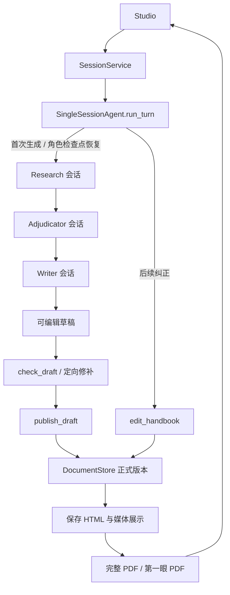

# 技术架构

本文以 2026-11-18 冻结构建 `a5adb2979c816bfd` 为基础（发布时保留两处既有渲染目录适配），说明当前入口如何运行，以及能力模块与历史实现的边界。验证结果见 [发布说明](RELEASE-2026-11-18.md)，启动步骤见 [运行说明](RUNNING.md)。

`packages/` 与 `tests/` 由本版加密归档解密后提供。下文后端路径是源码索引，只有授权解密后可见。

## 1. 三部分共同构成产品

| 部分 | 责任 | 代表入口 |
| --- | --- | --- |
| 前端 | 收集输入，展示进度、保存版本、修订回执与下载 | `apps/v1/studio.html`、`studio.js`、`studio-saved-handbook.js` |
| 工作流 | 首次生成的角色协作、草稿补齐、已有版本编辑 | `single_session_agent.py`、`single_session_roles.py` |
| 后端能力与运行环境 | 搜索读页、证据、价格计算、版本、预算、缓存、渲染、失败记录 | `single_session_document.py`、`single_session_api.py` 及各能力模块 |

模型决定如何理解需求、选择信息和安排旅行。运行环境负责让模型面对真实状态、有限预算和可检查的工具结果。

前端不单独生成另一份手册。保存手册面板通过同源 iframe 展示服务端 HTML；新一轮运行或失败时，已有版本保持可读。

## 2. 当前默认执行路径

`tools/serve_single_session.py` 启动 `SessionService` 与 HTTP 服务，绑定本地回环地址和独立数据目录。临时预览再通过 `tools/start_customer_preview.py` 组织网关与相关服务。

首次调用的实际分支位于 `single_session_agent.py` 的 `_run_turn`：首次 intake 进入 `single_session_roles.generate`。角色检查点恢复也进入这一入口。后续修订进入当前会话的工具调用循环。

当前生成角色按研究、裁决、成文的顺序执行，各自持有独立对话和预算。读页等工具可以有受限并发，但这不等于三个角色并行撰写同一方案。

## 3. 角色如何交接

| 角色 | 主要可用工具 | 交付给下一步的内容 |
| --- | --- | --- |
| Research | `search`、`read_page`、候选读取、价格研究清单、工作计划 | 实际来源、候选索引、原文片段、覆盖情况与具体缺口 |
| Adjudicator | 候选原文读取、`record_evidence`、有界补查 | 绑定来源的证据编号、条件、逐项裁决与未决项 |
| Writer | 证据/候选读取、草稿编辑和检查、正式发布 | 结构化日程、读者正文与正式保存回执 |

`single_session_handoff.py` 为现有产物构造视图。完整原文保存在来源记录中，角色交接主要传递来源身份、逐字片段、证据条件与 hash；需要更多上下文时按来源 ID 和偏移读取。

成文者可以检查资料，但不能通过研究工具重新建立另一份事实台账，也不能自行制造证据编号。裁决失败时保留已成功登记的证据，其余候选降级为未知，并携带失败原因继续移交。

交接并不消除模型错误。遗漏条件、误解实体或不充分读取原文仍可能发生，必须通过真实运行和产物复核观察。

## 4. 一次旅行的数据归属

| 数据 | 权威归属 | 用途 |
| --- | --- | --- |
| 用户输入、回合与工具历史 | 行程会话记录 | 保留明确需求、后续纠正与执行上下文 |
| 实际读到的来源 | 文档来源记录 | 保留 URL、原文、读取时间和内容 hash |
| 已登记证据 | 证据台账 | 绑定声明、引文、条件、核验状态与金额口径 |
| 未完成的初稿 | `drafts/current.json` | 保存可编辑中间结果，不作为正式版本 |
| 正式旅行手册 | `DocumentStore` | 维护版本、正文、结构化内容、hash 与编辑回执 |
| 角色进度 | `roles/state.json` 及角色产物 | 保留恢复游标、预算、失败与降级信息 |
| 产品调用 | 持久化调用账 | 区分已发送、返回、结算、失败与剩余额度 |
| HTTP 作业状态 | API 记录 | 将运行、失败和产物状态提供给前端 |

共享状态不靠把完整历史反复拼进提示词。文件与台账保存事实，模型上下文读取当前任务所需的投影；关键绑定与适用条件必须保留。

## 5. 草稿、检查与正式版本

初稿允许逐日、逐字段写入。`single_session_draft.py` 将这些中间结果标为 `unvalidated`、`document_saved=false`，和正式文档分开。

Writer 根据工作包补齐可写单元，使用 `check_draft` 获取具体缺项，再调用 `publish_draft` 进入既有正式保存路径。草稿检查只是对可检查结构和规则的反馈，不能代替内容判断。

后续修订使用 `edit_handbook`，携带当前版本与原始字段值。结构化日程是页面内容的依据，修改正文中的一句描述不能被当作已经修改实际日程。

程序提供真实 diff 和版本回执；模型负责同步直接受影响的摘要、日程、预算、交通、速览与条件分支。版本保护可以阻止旧值覆盖，不能独自判断用户意图是否被正确落实。

## 6. 证据与金额边界

`single_session_document.py` 处理来源登记、引文绑定、价格标记、计算和版本保存，不承担来源权威或语义正确性的裁决。

实际研究采用 `search → read_page → record_evidence`。检索结果是线索，登记证据必须绑定已保存原文中的引文。实体、日期、票种、人数、包含项和独立来源关系仍由模型判断。

已核金额使用 `{{price:E1}}` 一类标记，程序根据台账执行单价与人数计算。预算估算使用独立字段、假设和乘式，不把未知开销折算为零。

同样，`single_session_handoff.py` 可计算已知时间字段之间的余量。没有明确时长、同一钟表口径或匹配交通字段时，结果保持未知，不补出一段推测交通。

多语言研究规则位于 `single_session_agent.py` 的研究与目的地规格中。它表达要做的工作，不能作为已经覆盖全部语言、来源和目的地的运行证据。

## 7. 供给缓存与记忆的实际范围

当前主路径的 `SessionSupply` 对已保存文档中的合格证据进行尽力缓存，并通过 `SupplyCache` 保留来源、核验时间和显式适用条件。

复用要求匹配目的地及显式上下文摘要，并满足时效规则。缓存读取不会更新原核验时间，过期或不适用时回到实时读取；缓存失败不重复正式文档保存。

另外，`lifecycle_atoms.py` 提供按目的地分区的供给证据生命周期台账，包含声明、来源、逐字引文、季节范围、核验日期、失效日期与替代关系。它服务于独立能力和分阶段管线，不应与当前主路径的缓存机制混为一体。

`single_session_profiles.py` 保存用户显式填写的本地画像。会话连续性、来源复用和个人资料存储是三种不同机制；本版没有证明自动跨旅行学习和普遍适用的长期记忆已经完成。

## 8. 展示、媒体与 PDF

正式文档经过结构化投影形成读者版内容。来源和内部审计留在适当的记录中，不能把后台候选 JSON 当作读者手册输出。

媒体与 PDF 是独立交付步骤：图片需要正确实体与来源，地图不能替代缺失的景点照片；生成文件后还需记录产物状态、版本和 hash。

前端 `studio-saved-handbook.js` 只接受同源、正确行程路径的后端产物 URL，并校验可用状态与版本。第一眼下载要求 `ready`，完整手册保留既有降级展示策略。

最新演示仍出现「API delivery 为 ready、presentation 为 degraded」的差异。因此，本版不能把某一个 ready 字段解释为全册所有质量维度通过。

## 9. 服务可靠性与可恢复性

每个实例配置独立数据目录，`SessionService` 在实例内串行管理同一会话的写操作；没有跨进程独占锁保证。API 将请求身份、版本/hash 绑定与作业记录结合，避免把不同操作的结果互相覆盖。

本版对调度失败、持久化失败、deadline、后台清理、来源晚写和旧产物状态做了有界修复：失败要落到实际作业，已经保存的版本要继续可读，不把迟到结果发布为当前成功。

这些机制有明确范围：来源读改写锁在同一服务进程内生效；deadline 不是强杀外部请求或撤回已产生费用；已有保存状态也不等于跨浏览器凭据恢复已经完成。

恢复与重试需要检查原操作和已保存状态。进程重新启动不会自动重放未完成的模型请求。

## 10. 能力模块与历史管线

仓库中保留了不同阶段的产品实验。下面是代码归属，不是对所有用户路径的验收声明。

| 代码 | 责任及与主路径的关系 |
| --- | --- |
| `comparison_card*.py` | 两方案比较及生成、选择、调整；由 `single_session_comparison.py` 适配到行程，选择本身不编辑手册 |
| `intent_questions*.py` | 生成可撤回假设、暂定方案和零到三个关键问题 |
| `intent_revision*.py` | 在正式 TripStore 中应用有范围的意图修订与选择性撤销；不同于当前单会话编辑端点 |
| `supply_research.py`、`source_adapters/` | 供给研究、来源读取与标准化能力 |
| `atomic_orchestration.py`、`capability_tools.py` | 模型选择有界研究动作，程序限制工具范围并记录结果 |
| `itinerary_assembly*.py` | 将冻结能力产物和已有计划组装为手册的独立能力 |
| `single_session_orchestration.py`、`single_session_orch_backend.py` | 保留的五阶段编排路径，不是当前首次生成默认分支 |
| `autopilot_*`、`runtime_*` | 其他工作流与分阶段实现；不能由文件名推断当前 Studio 已使用全部能力 |

当前路线的核心是单会话中的角色协作与正式文档编辑。能力模块可以复用，但每次接线都要明确状态所有者、预算来源、输入输出和验证范围。

## 11. 代码阅读索引

以下后端路径均相对于解密后的 `packages/travel_agent/`：

| 想理解什么 | 先读 |
| --- | --- |
| HTTP 作业、状态恢复、服务归属 | `single_session_api.py` |
| 首次生成和后续修改如何分支 | `single_session_agent.py` |
| 三角色的工具范围、预算与游标 | `single_session_roles.py`、`single_session_role_budget.py` |
| 来源与证据如何交接 | `single_session_handoff.py` |
| 初稿如何逐步写成正式结果 | `single_session_draft.py`、`single_session_writer_prompt.py` |
| 证据、金额、版本和修改回执 | `single_session_document.py`、`single_session_edit_binding.py` |
| 缓存的时效与范围 | `single_session_supply.py`、`supply_cache.py` |
| 展示和 PDF 产物 | `single_session_presentation_delivery.py`、`single_session_pdf.py`、`single_session_pdf_runner.py` |

前端可直接阅读 [Studio 控制器](../apps/v1/studio.js)、[保存手册面板](../apps/v1/studio-saved-handbook.js) 和 [比较入口](../apps/v1/studio-session-comparison.js)。
