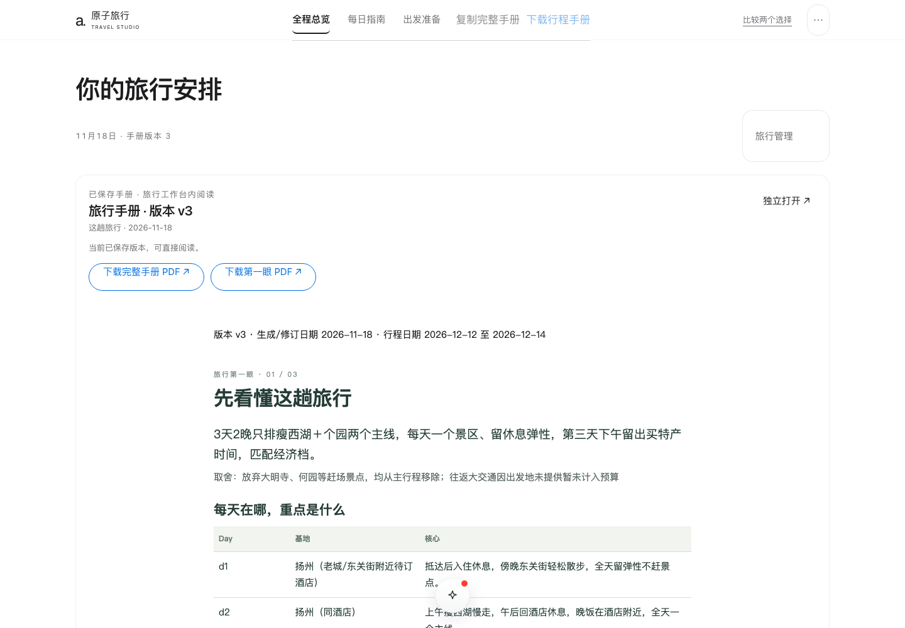
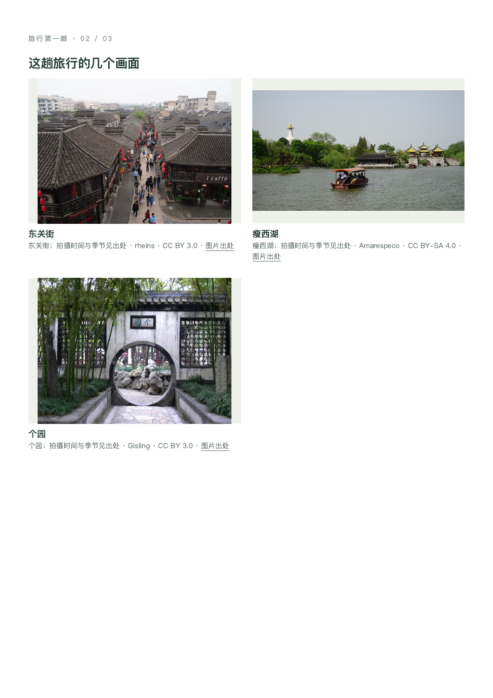

# 扬州缓存续改：一次真实演示

这段演示记录了 **缓存 v2 → 一次用户纠正 → 保存 v3 → 刷新恢复 → 导出双 PDF**。素材来自 2026-11-18 的真实前端操作和本次产物，演示使用已有扬州行程的隔离副本。

[播放 / 下载 90 秒视频](media/trip-autopilot-demo.mp4?raw=1) · [完整手册 PDF](examples/yangzhou-v3-full.pdf) · [下载只读 HTML](examples/yangzhou-v3.html?raw=1) · [第一眼速览 PDF](examples/yangzhou-v3-first-eye.pdf) · [返回 README](../README.md)

视频将等待压缩为剪辑片段，**实际从用户提交到终态观测为 494.628 秒，约 8 分 15 秒**，包含内部重试。90 秒是视频长度，不是产品响应时间；GitHub 若未直接播放，可通过上方链接下载。

## 这一次改了什么

用户在已有 v2 上提出：

> 第二天不去大明寺，瘦西湖后回酒店休息，晚饭在酒店附近；其他两天及日期、人数、预算上限保持。

| 检查项 | 实际观察 |
| --- | --- |
| 第二天 | 保存后的 v3 移除大明寺，并调整休息与晚餐安排 |
| 关联内容 | 日程、摘要与第一眼路线同步修改 |
| 保持项 | 第一天、第三天完整结构与修改前一致 |
| 修改回执 | 实际 diff、改了什么、判断、替代方案和下一步已保存 |
| 刷新恢复 | 仍为同一行程的 v3；本次刷新未增加模型调用 |
| 下载 | HTML、18 页完整 PDF、3 页第一眼 PDF；前端下载字节 hash 与同版本保存产物一致 |

一次用户提交触发了两次内部编辑模型调用。第一次编辑因旧字段值不匹配被原子拒绝，没有写入；第二次根据工具反馈修正后保存成功。这次结果包含内部重试。

## 直接看交付物

| 文件 | 用途 | 本次产物 |
| --- | --- | --- |
| [只读 HTML](examples/yangzhou-v3.html?raw=1) | 下载后在浏览器本地打开，无需登录或模型凭据 | v3，与本次保存 HTML 字节一致 |
| [完整旅行手册](examples/yangzhou-v3-full.pdf) | 详细阅读行程、交通、预算口径与待确认内容 | v3，18 页 |
| [第一眼速览](examples/yangzhou-v3-first-eye.pdf) | 快速查看路线与重点 | v3，3 页 |
| [演示视频](media/trip-autopilot-demo.mp4?raw=1) | 查看纠正、等待、回执和成品过程 | 90 秒，等待已压缩 |

本次检查了 21 页 PDF 接触表及重点页面，确认三个核心景点照片和每日地图在位。产物可以下载，仍不代表全册所有质量维度已经通过。

## 实际耗时与调用

| 项目 | 记录 |
| --- | --- |
| 用户提交 | 1 次真实前端提交 |
| 等待 | 494.628 秒，约 8 分 15 秒；含内部重试 |
| 新增产品调用 | 4 次：2 次编辑模型、2 次媒体模型 |
| 输入 / 输出 | 44,886 / 46,207 tokens |
| 推理用量 | 已知 34,074 tokens，已包含在输出中，不重复相加 |
| 未知 token 用量 | 0 |
| 费用 | 保守估算 ¥1.651563，约 ¥1.65；服务商实际账单未知 |
| 刷新与导出 | 本次未增加模型调用 |

等待时间以用户提交至终态观测为准，不包含终态之后的录屏与下载操作。费用为估算，不能当作供应商实付账单或未来每次运行的固定价格。

## 已知限制

- **小修改仍慢。** 本次等待约 8 分 15 秒，不能据此承诺即时修改或稳定响应时间。
- **图片仍有缺口。** 三个核心景点有照片，「特产采购」缺少合适图片，照片覆盖 3/4，展示状态为 `degraded`。
- **状态口径仍不一致。** API delivery 为 `ready`，未列出对应 `quality_gaps`，与展示状态存在差异；演示没有通过改状态掩盖这一点。
- **缓存事实未全部重核。** 票价、开放时段等仍有单源或未核项，本次没有重新采集、逐条核验全册外部事实，也没有完成预订。
- **下载命名待改善。** 实际浏览器将两份 PDF 都建议命名为 `pdf.pdf`；本页公开样例按完整版与第一眼版区分。

## 证据范围与录制方式

本次有界独立复核支持的是修正、保持、版本、导出和刷新链路。它没有证明从零新行程的首次自主完整交付，也没有证明全部事实正确、图片完整或跨浏览器恢复已完成。

演示使用隔离副本，原始行程文件未变。剪辑采用实际录屏和本次 PDF 渲染，区分缓存 v2、本次真实提交、压缩等待和 v3；旁白采用离线系统语音。临时演示服务在录制后已停止。

公开素材用于查看产品结果，私有会话、原始付费回包和凭据不随仓库分发。本次仓库更新没有重新部署现有服务，也没有新增产品模型调用。

关于发布包的回归、启动检查及其边界，见 [2026-11-18 发布说明](RELEASE-2026-11-18.md)；关于正式版本、证据与导出的实现，见 [技术架构](ARCHITECTURE.md)。

素材身份与逐文件 SHA-256 见 [样例清单](examples/manifest.json)；图片署名与许可记录见 [素材出处](media/ATTRIBUTION.md)。
